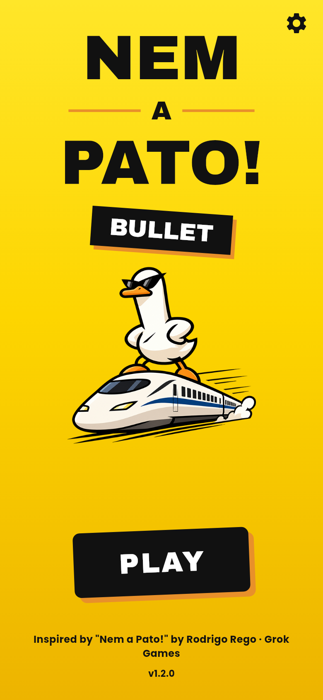
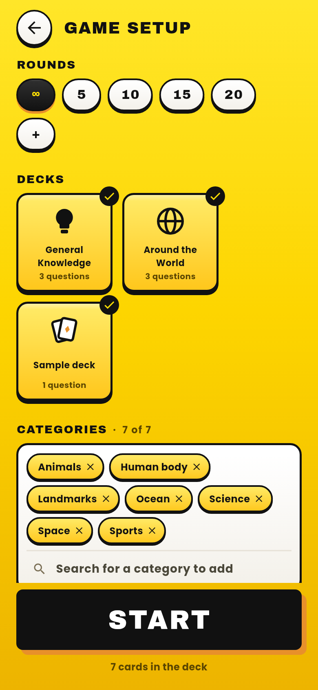
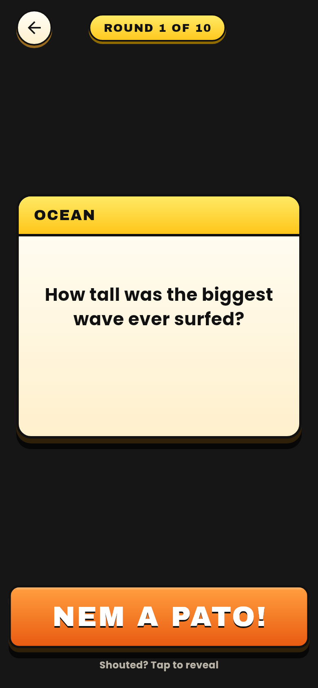
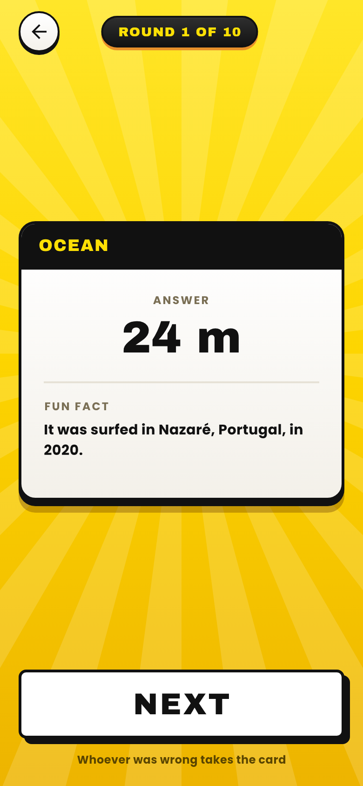
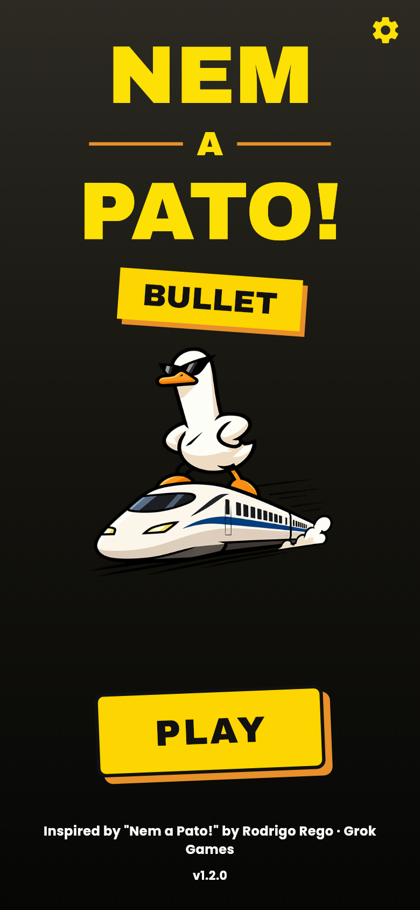
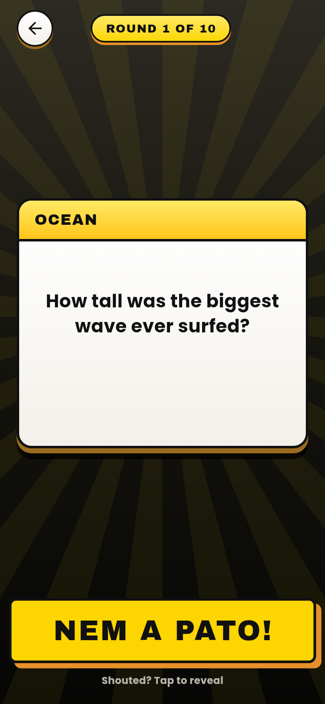
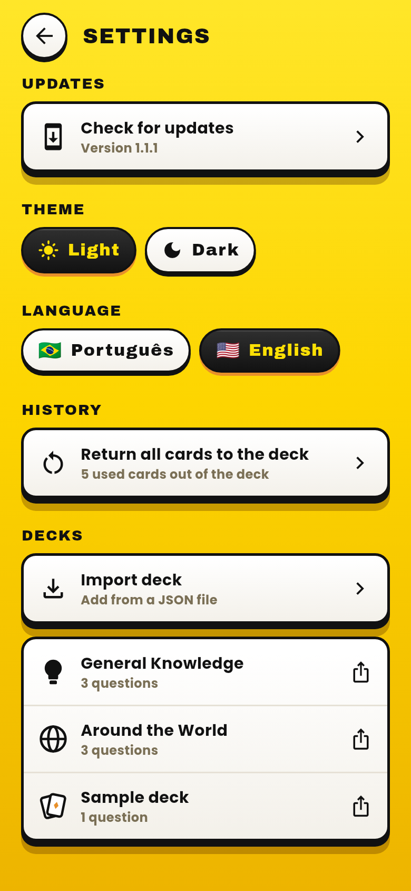
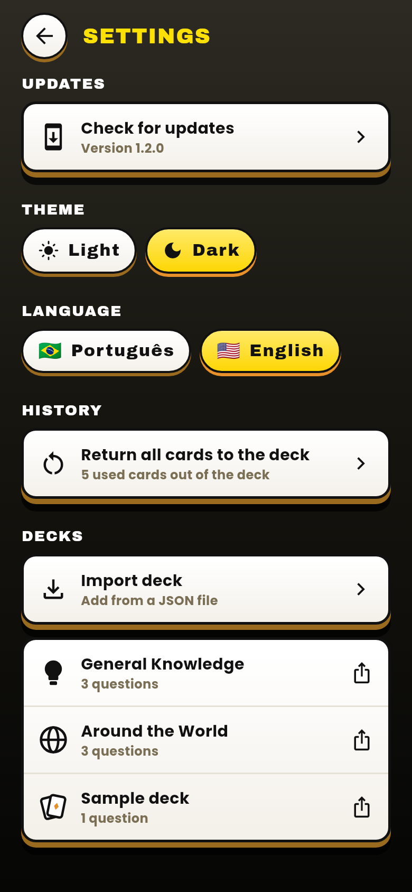

# Nem a Pato! Bullet

[](https://github.com/WandersoNoleto/nem-a-pato-bullet/releases/latest)
[](https://github.com/WandersoNoleto/nem-a-pato-bullet/releases)
[](https://flutter.dev)
[](https://dart.dev)
[](https://github.com/WandersoNoleto/nem-a-pato-bullet/releases/latest)
[](#features)
[](LICENSE)

A fan-made, **offline** card deck for playing the trivia party game *Nem a Pato!* at the table. Everyone guesses a number, each guess higher than the last, without going over the real answer. Think the last guess went too far? Shout **"Nem a Pato!"**, flip the card and see who was wrong.

> [!NOTE]
> Unofficial fan project based on the board game *Nem a Pato!*. See the [credits](#credits).

**[Download the APK](https://github.com/WandersoNoleto/nem-a-pato-bullet/releases/latest)** · **[How to play](#how-to-play)** · **[Features](#features)** · **[Decks](#decks)** · **[Build from source](#build-from-source)** · **[Credits](#credits)**

<p align="center">
  
  
  
  
</p>

## How to play

The app is the deck; the game happens at the table.

1. **Set up the game:** pick the number of rounds, the decks and the categories, then tap **START**.
2. **Read the card** out loud. Every answer is a number.
3. **Guess around the table:** each player says a number higher than the last one, trying not to go over the answer.
4. **Challenge:** when someone thinks the last guess went too far, they shout "Nem a Pato!" and tap the button to flip the card.
5. **Whoever loses the challenge is out of the game.** The last player standing wins.

> [!NOTE]
> The app only shows the cards: it doesn't track players, eliminations or how many cards each one has. That part stays at the table. If you'd rather play the classic way, keep score yourselves: whoever loses a challenge takes a card, and the player with the most cards at the end is the duck of the table.

## Features

- **Game setup:** infinite rounds or 5, 10, 15, 20 or a custom number; pick decks and categories, with search to add categories back.
- **3D card flip:** the answer and a fun fact are revealed with a tap.
- **No repeats:** cards that came up stay out of the deck, even after closing the app. Return them from the settings, or only the current game's cards when they run out.
- **Your own decks:** import decks from JSON files and export any deck to share it.
- **Deck symbols:** each deck can have its own SVG symbol.
- **Light and dark themes:** a yellow theme and a dark one, switched in the settings and remembered on the device.
- **Portuguese and English:** the app's texts switch language; deck content always stays exactly as written.
- **Auto-update:** the app checks GitHub Releases and offers new versions.
- **Fully offline**, portrait, made for Android.

<p align="center">
  
  
  
  
</p>

## Install

Download `nem-a-pato-bullet-<version>.apk` from the **[latest release](https://github.com/WandersoNoleto/nem-a-pato-bullet/releases/latest)** and open it on your Android phone. Android will ask you to allow installs from this source.

After that, the app offers new versions by itself when it opens.

## Decks

The app does not ship the original game's questions. Questions live in JSON decks, kept separate from the code:

- `assets/decks/sample.json`: a sample deck with original questions, bundled with the app.
- `decks/demo/`: extra decks with original questions, used for demo builds.
- `decks/private/`: personal decks; ignored by Git and never published.

Players can also import decks from the settings screen. A deck with the same name as an existing one replaces it.

| Field | Required | Notes |
| --- | --- | --- |
| `name` | yes | Deck name shown in the game setup |
| `icon` | no | Deck symbol as inline SVG, painted in the app's ink color; a playing-card symbol is shown when missing |
| `questions` | yes | List of questions, fields below |
| `category` | yes | Shown above the question |
| `text` | yes | The question |
| `answer` | yes | Shown exactly as written |
| `fact` | no | Shown with the answer when present |

<details>
<summary>Example deck</summary>

```json
{
  "name": "Sample deck",
  "icon": "<svg xmlns=\"http://www.w3.org/2000/svg\" viewBox=\"0 0 24 24\">...</svg>",
  "questions": [
    {
      "category": "Espaço",
      "text": "Quantos planetas tem o Sistema Solar?",
      "answer": "8 planetas",
      "fact": "Plutão foi reclassificado como planeta-anão em 2006."
    }
  ]
}
```

</details>

Question ids are not part of the file: the app derives each one from the category and text, so a question is never repeated, even after re-importing its deck. Deck content can be in any language; the sample deck is in Brazilian Portuguese.

## Build from source

Requires Flutter (stable).

```bash
flutter pub get
flutter run
```

<details>
<summary>Tests, screenshots and releases</summary>

**Tests**

```bash
flutter analyze
flutter test
```

**README screenshots**, rendered from the real screens in English:

```bash
UPDATE_SCREENSHOTS=1 flutter test test/screenshots
```

**Signed release APK.** Needs `android/key.properties` (see `android/key.properties.example`). The version comes from `pubspec.yaml`, as `X.Y.Z+code` with code = X×1000000 + Y×10000 + Z×100:

```bash
tool/build_release.sh
```

Then publish a GitHub release tagged `vX.Y.Z` with the APK attached, so the auto-update finds it.

**Demo APK** with the decks in `decks/demo/`:

```bash
tool/build_demo.sh
```

</details>

## Credits

Inspired by [*Nem a Pato!*](https://loja.grokgames.com.br/nem-a-pato), designed by **Rodrigo Rego** and published in Brazil by **Grok Games** (original edition: *How Dare You?*, Alion). This is a non-profit study project, not affiliated with or endorsed by Grok Games or the designer.

## License

The source code is licensed under [MIT](LICENSE). The *Nem a Pato!* name and the mascot derived from Grok Games' character are **not** covered by this license.
