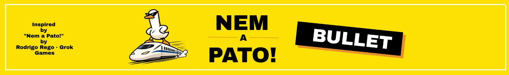

# Nem a Pato! Bullet



A simplified, fan-made digital version of the *Nem a Pato!* mechanic: everyone guesses a number, each guess higher than the last, without going over the real answer. If you think the last guess went too far, shout **"Nem a Pato!"** to challenge it, and whoever was wrong takes the card.

A non-profit study project built with Flutter, made to play with friends.

## Credits

Inspired by [*Nem a Pato!*](https://loja.grokgames.com.br/nem-a-pato), designed by **Rodrigo Rego** and published in Brazil by **Grok Games** (original edition: *How Dare You?*, Alion). This project is not affiliated with or endorsed by Grok Games or the designer.

## Decks

The app does not ship the original game's questions. Questions live in JSON decks, kept separate from the code:

- `assets/decks/sample.json`: a sample deck with original questions.
- `decks/private/`: personal decks; ignored by Git and never published.

Deck format:

```json
{
  "name": "Sample deck",
  "questions": [
    {
      "category": "Espaço",
      "text": "Quantos planetas tem o Sistema Solar?",
      "answer": "8 planetas",
      "fact": "Plutão foi reclassificado como planeta-anão em 2006."
    }
  ]
}
```

| Field | Required | Notes |
| --- | --- | --- |
| `category` | yes | Shown above the question |
| `text` | yes | The question |
| `answer` | yes | Shown exactly as written |
| `fact` | no | Shown with the answer when present |

Question ids are not part of the file: the app derives each one from the category and text, so a question is never repeated, even after re-importing its deck. Deck content can be in any language; the sample deck is in Brazilian Portuguese.

## Running

```bash
flutter pub get
flutter run
```

## License

The source code is licensed under [MIT](LICENSE). The *Nem a Pato!* name and the mascot derived from Grok Games' character are **not** covered by this license.
