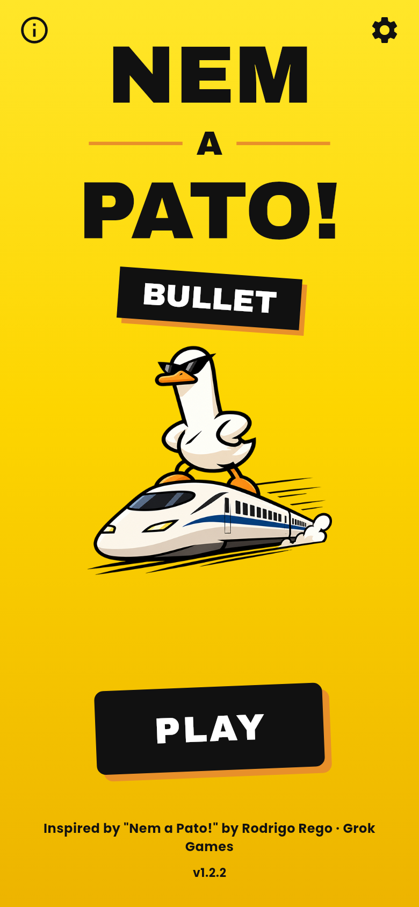
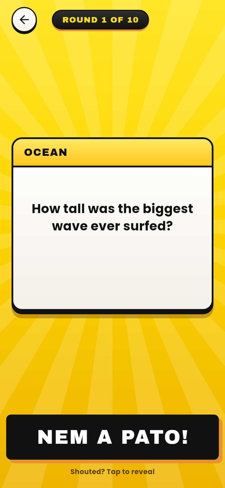
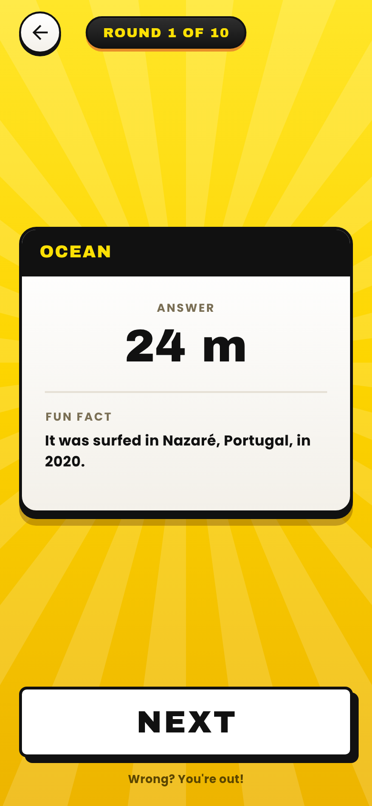
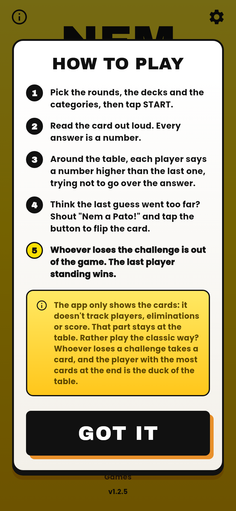
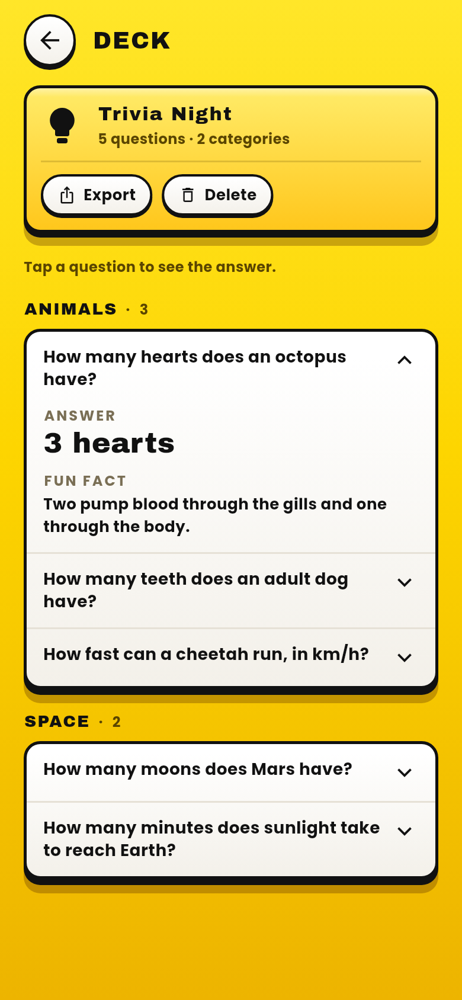
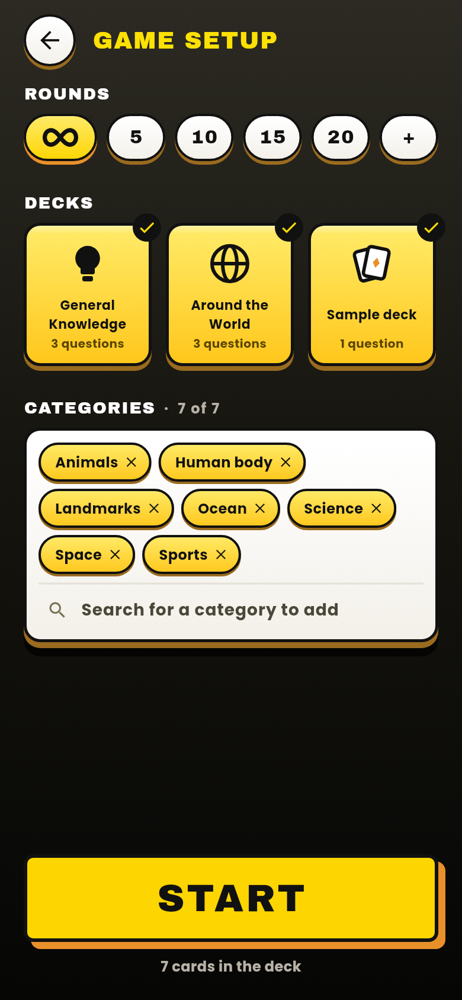
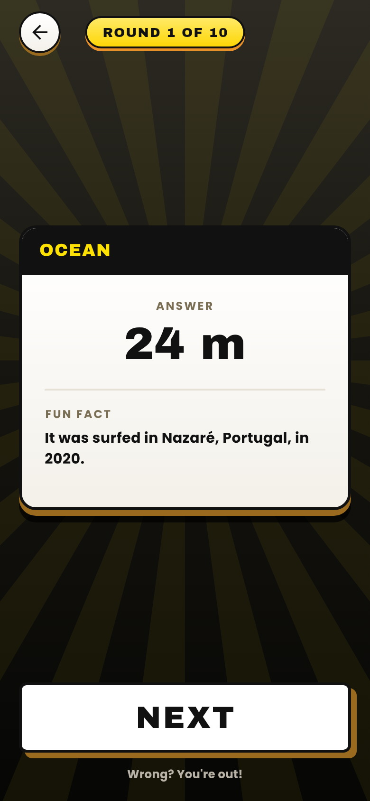

# Nem a Pato! Bullet

[](https://github.com/WandersoNoleto/nem-a-pato-bullet/releases/latest)
[](https://github.com/WandersoNoleto/nem-a-pato-bullet/releases)
[](https://flutter.dev)
[](https://dart.dev)
[](https://github.com/WandersoNoleto/nem-a-pato-bullet/releases/latest)
[](#whats-in-the-game)
[](LICENSE)

**The trivia party game where every answer is a number, and nobody knows how far to push it.**

How many teeth does a dog have? How tall is a soccer goal? Around the table, each player bids a number higher than the last, without going over the real answer. When someone thinks the last bid went too far, they shout **"Nem a Pato!"**, a pun on the Brazilian "nem a pau" ("no way!"), flip the card and see who was wrong.

This app is the deck: a fan-made, **offline** companion for the board game *Nem a Pato!*, with a duck in sunglasses riding a bullet train.

> [!NOTE]
> Unofficial fan project based on the board game *Nem a Pato!*. See the [credits](#credits).

**[Get the app](https://github.com/WandersoNoleto/nem-a-pato-bullet/releases/latest)** · **[Try the demo](#try-the-demo)** · **[How to play](#how-to-play)** · **[What's in the game](#whats-in-the-game)** · **[Make your own deck](#make-your-own-deck)**

<p align="center">
  
  
  
  
</p>

## How to play

**You need:** this app, two or more friends, and the nerve to bid one number too high.

1. **Set up the game:** pick the rounds, the decks and the categories, then tap **START**.
2. **Read the card** out loud. Every answer is a number.
3. **Bid around the table:** each player says a number higher than the last one, trying not to go over the answer.
4. **Call it:** think the last bid went too far? Shout **"Nem a Pato!"** and tap the button to flip the card. The duck quacks, the answer shows up.
5. **Whoever loses the challenge is out.** If the bid was over the answer, the bidder is out; if not, whoever shouted is. The last player standing wins.

> [!TIP]
> The app only shows the cards. Players, eliminations and score stay at the table. Rather play the classic way? Whoever loses a challenge takes a card, and the player with the most cards at the end is the duck of the table.

## What's in the game

### At the table

- **The card flip:** tap "Nem a Pato!" and the card turns over in 3D, showing the answer and a fun fact.
- **The quack:** every challenge comes with a duck quack and a short vibration. Playing somewhere quiet? Turn the sound off in the settings; the vibration stays.
- **No repeats:** a card that came up stays out of the deck, even after you close the app. Out of cards? Put this game's cards back and keep going, or return every card from the settings.
- **Round counter:** the top of the screen shows the round, and the total when the game has a limit.
- **Rules at hand:** the info button on the home screen explains how to play, step by step.

### Before the game

- **Rounds:** infinite (the default), 5, 10, 15, 20 or any number up to 999.
- **Decks:** pick one or more from a grid of deck tiles.
- **Categories:** all of them start in. Tap one to leave it out, search to bring it back, or select all again.
- **Cards left:** the setup tells you how many unused cards your choices leave.

### Your decks

- **Deck page:** open a deck in the settings to see its symbol, language, categories and questions. Answers stay hidden until you tap, so browsing won't spoil the game.
- **Import, export, delete:** load decks from JSON files, share any deck as a file, and delete the ones you imported.
- **Comes with the app:** decks shipped with the app are labeled and can't be deleted.
- **Deck symbols and language:** each deck can have its own symbol, and can say which language its questions are in, shown by name, like "Portuguese (Brazil)".

### Your phone

- **Light and dark themes:** a yellow table or a dark one.
- **Portuguese and English:** the app's texts switch language; the cards always stay exactly as written.
- **Any screen:** small phones, big phones, tablets and large system fonts.
- **Auto-update:** new versions show up when you open the app, with the mascot train running along the download bar.
- **Fully offline**, portrait, made for Android.

## Screens

<table>
  <tr>
    <td align="center" width="25%"><br><sub><b>Home</b><br>Play, rules and settings</sub></td>
    <td align="center" width="25%"><br><sub><b>How to play</b><br>The rules, one tap away</sub></td>
    <td align="center" width="25%"><br><sub><b>Game setup</b><br>Rounds, decks and categories</sub></td>
    <td align="center" width="25%"><br><sub><b>Question</b><br>Read it out loud and guess</sub></td>
  </tr>
  <tr>
    <td align="center"><br><sub><b>Answer</b><br>The card flips to reveal it</sub></td>
    <td align="center"><br><sub><b>Settings</b><br>Theme, language, sound and decks</sub></td>
    <td align="center"><br><sub><b>Deck</b><br>Questions by category, answers on tap</sub></td>
    <td align="center"><br><sub><b>Dark theme</b><br>Every screen, switched in the settings</sub></td>
  </tr>
</table>

<details>
<summary>More screens in the dark theme</summary>

<p align="center">
  
  
  
  
  
  
</p>

</details>

## Get the app

Download `nem-a-pato-bullet-<version>.apk` from the **[latest release](https://github.com/WandersoNoleto/nem-a-pato-bullet/releases/latest)** and open it on your Android phone. Android will ask you to allow installs from this source. After that, the app offers new versions by itself.

## Try the demo

Want more cards to play with? Two demo apps come loaded with **83 questions in 6 decks**: games, sports, movies, science, world records and trivia.

| Demo | Language | Download |
| --- | --- | --- |
| Nem a Pato! Demo PT | Brazilian Portuguese | [nem-a-pato-bullet-demo-pt-BR.apk](https://github.com/WandersoNoleto/nem-a-pato-bullet/releases/latest/download/nem-a-pato-bullet-demo-pt-BR.apk) |
| Nem a Pato! Demo EN | English | [nem-a-pato-bullet-demo-en-US.apk](https://github.com/WandersoNoleto/nem-a-pato-bullet/releases/latest/download/nem-a-pato-bullet-demo-en-US.apk) |

The demos are separate apps: they install next to the regular one, start in their own language and come with their decks ready to play.

> [!TIP]
> **Recommended:** the demos don't receive updates. For the best experience, get the [latest version of the app](https://github.com/WandersoNoleto/nem-a-pato-bullet/releases/latest) and import the demo decks from the settings, using the JSON files in [`decks/demo/pt-BR`](https://github.com/WandersoNoleto/nem-a-pato-bullet/tree/main/decks/demo/pt-BR) or [`decks/demo/en-US`](https://github.com/WandersoNoleto/nem-a-pato-bullet/tree/main/decks/demo/en-US).

> [!WARNING]
> The demo questions were **generated with AI**, only for demonstration. Their answers are not guaranteed to be accurate. At the table, **the answer in the app is the one that counts**.

## Make your own deck

The app doesn't ship the original game's questions, so the fun is in bringing your own. A deck is a JSON file: write it, import it from the settings, and it's in the game.

**What makes a good card:**

- **One number as the answer.** A challenge needs a clear winner, so avoid "about", "over" or ranges in the answer.
- **Approximate? Say it in the question.** "Approximately how long does sunlight take to reach Earth? (minutes)" → `8 minutes`.
- **Give the unit when it isn't obvious**, at the end: "How tall is a soccer goal? (m)". Skip it when the question already says it: "In what year...".
- **A fun fact** makes the reveal better.

| Field | Required | Notes |
| --- | --- | --- |
| `name` | yes | Deck name shown in the game setup |
| `icon` | no | Deck symbol as inline SVG, painted in the app's ink color; a playing-card symbol is shown when missing |
| `language` | no | Language of the questions as a code like `pt-BR`, `en` or `es-419`; shown on the deck page |
| `questions` | yes | List of questions, fields below |
| `category` | yes | Shown above the question |
| `text` | yes | The question |
| `answer` | yes | Shown exactly as written |
| `fact` | no | Shown with the answer when present |

<details>
<summary>Example deck</summary>

```json
{
  "name": "Sample deck",
  "language": "pt-BR",
  "icon": "<svg xmlns=\"http://www.w3.org/2000/svg\" viewBox=\"0 0 24 24\">...</svg>",
  "questions": [
    {
      "category": "Espaço",
      "text": "Quantos planetas tem o Sistema Solar?",
      "answer": "8 planetas",
      "fact": "Plutão foi reclassificado como planeta-anão em 2006."
    }
  ]
}
```

</details>

A few more details:

- **Same name, new deck:** importing a deck with the name of one you have replaces it.
- **No repeats across imports:** each question's id comes from its category and text, so a card that came up stays out even if you import its deck again.
- **Language codes** are written the usual way (`pt-br` is stored as `pt-BR`); a value that isn't a language code makes the file invalid.
- **Where the decks live in this repository:**
  - `assets/decks/sample.json`: a small sample deck, bundled with the app.
  - `decks/demo/pt-BR/` and `decks/demo/en-US/`: the [demo](#try-the-demo) decks, the same 83 questions in each language.
  - `decks/private/`: personal decks, ignored by Git and never published.

## For developers

Requires Flutter (stable).

```bash
flutter pub get
flutter run
```

<details>
<summary>Tests, screenshots and releases</summary>

**Tests**

```bash
flutter analyze
flutter test
```

**README screenshots**, rendered from the real screens in English:

```bash
UPDATE_SCREENSHOTS=1 flutter test test/screenshots
```

**Signed release APK.** Needs `android/key.properties` (see `android/key.properties.example`). The version comes from `pubspec.yaml`, as `X.Y.Z+code` with code = X×1000000 + Y×10000 + Z×100:

```bash
tool/build_release.sh
```

Then publish a GitHub release tagged `vX.Y.Z` with the APK attached, so the auto-update finds it. The app only updates to the APK without "demo" in its name.

**Demo APKs**, one per folder in `decks/demo/`, named `nem-a-pato-bullet-demo-<locale>.apk` and attached to the same release:

```bash
tool/build_demo.sh
```

Pass `pt-BR` or `en-US` to build only one of them.

</details>

## Credits

Inspired by [*Nem a Pato!*](https://loja.grokgames.com.br/nem-a-pato), designed by **Rodrigo Rego** and published in Brazil by **Grok Games** (original edition: *How Dare You?*, Alion). This is a non-profit study project, not affiliated with or endorsed by Grok Games or the designer.

The duck quack is a sound by freesound_community, from [Pixabay](https://pixabay.com/sound-effects/), used under the Pixabay Content License.

## License

The source code is licensed under [MIT](LICENSE). The *Nem a Pato!* name and the mascot derived from Grok Games' character are **not** covered by this license.
